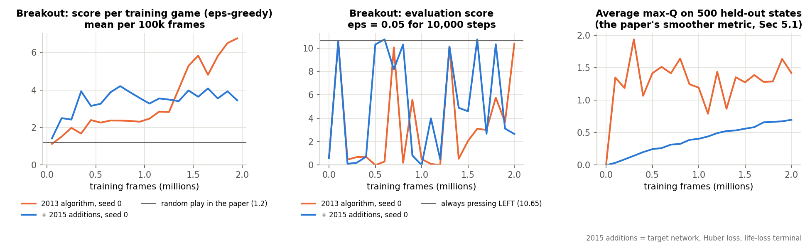
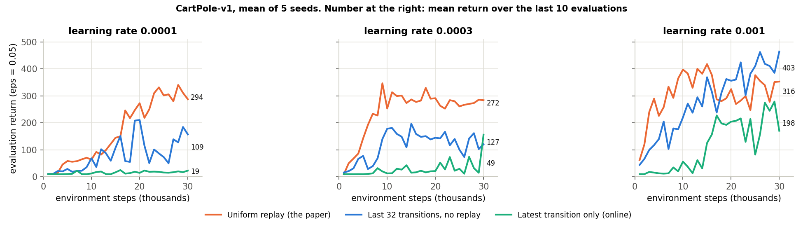

# DQN from scratch: "Playing Atari with Deep Reinforcement Learning" (Mnih et al., 2013)

Deep Reinforcement Learning (AIMLCZG512), BITS Pilani WILP, Assignment Problem II, Group 51.

A PyTorch re-implementation of Algorithm 1 of [arXiv:1312.5602](https://arxiv.org/abs/1312.5602), a small-budget
training run on Atari Breakout, and a small ablation of experience replay. Everything on the "our own work"
slides of the presentation comes from the code and the logs in this repository.

## Files

| File | What it is |
|---|---|
| `dqn_atari.py` | The agent: pre-processing, Q-network, replay memory, training loop, evaluation |
| `replay_ablation.py` | CartPole experiment: uniform replay vs two ways of learning without replay |
| `watch_agent.py` | Plays games with a saved checkpoint; saves frames, a GIF and the max-Q trace |
| `value_check.py` | Compares predicted max-Q with the discounted return the agent really collects |
| `trick_check.py` | Compares the agent with the four "always press one button" policies |
| `plot_results.py` | Figures from the logs |
| `slide_numbers.py` | Prints the numbers quoted on the slides from the logs in `runs/` |
| `test_dqn.py` | Sanity checks (frame stack, replay memory, network size, one learning step) |
| `DQN_Atari_2013.ipynb` | The same code as one Colab / Kaggle notebook |
| `runs/` | Configs, logs and checkpoints of the runs we report |
| `figures/` | Plots made by `plot_results.py` |

## Setup

```bash
pip install -r requirements.txt      # the Atari ROMs ship with ale-py, nothing else to download
python test_dqn.py
```

## Reproduce our numbers

The notebook `DQN_Atari_2013.ipynb` runs these commands from top to bottom. We ran it on Google Colab with a
T4 GPU runtime (torch 2.11.0+cu130, gymnasium 1.3.0, ale-py 0.12.1).

```bash
# the 2013 algorithm, small budget (about 25 minutes on the Colab GPU)
python dqn_atari.py --game Breakout --steps 500000 --train-every 4 --seed 0 --out runs/breakout_cpu

# the same run with the three stabilisers of the 2015 Nature paper switched on (about 25 minutes)
python dqn_atari.py --game Breakout --steps 500000 --train-every 4 --seed 0 \
    --target-update 1000 --huber --life-loss-terminal --out runs/breakout_cpu_2015fixes

python watch_agent.py --run runs/breakout_cpu --games 5 --gif
python watch_agent.py --run runs/breakout_cpu --checkpoint model_best.pt --name watch_best
python watch_agent.py --run runs/breakout_cpu_2015fixes --games 5 --gif
python value_check.py --run runs/breakout_cpu
python value_check.py --run runs/breakout_cpu_2015fixes
python trick_check.py --run runs/breakout_cpu
python trick_check.py --run runs/breakout_cpu_2015fixes
python replay_ablation.py --out runs/ablation            # 45 CartPole runs on the CPU, about 36 minutes
python plot_results.py --runs runs/breakout_cpu runs/breakout_cpu_2015fixes --ablation runs/ablation --out figures
python slide_numbers.py                                   # the numbers quoted on the slides
```

The run folders are called `breakout_cpu` because the budget was sized to fit a CPU as well; `config.json` in each
folder records the device that was actually used (`cuda`).

With more GPU time, drop `--train-every 4` (one update per agent step, as in Algorithm 1) and raise `--steps`;
`--paper-scale` runs the full 10M frames with a 1M-frame replay memory.

## What follows the paper and what does not

| | Paper (Sec. 4 and 5) | `dqn_atari.py` default | Our runs |
|---|---|---|---|
| Pre-processing | grey, 110x84, crop 84x84, last 4 frames | same | same |
| Network | conv 16@8x8/4, conv 32@4x4/2, FC 256, one output per action | same (677,172 weights for 4 actions) | same |
| Learning | Q-learning, uniform replay, minibatch 32, RMSProp, no target network | same | same |
| Reward clipping, frame-skip | -1/0/+1, k = 4 | same | same |
| Exploration | eps 1.0 to 0.1 over the first 1M frames | over the first 0.4M frames | same as default |
| Evaluation | eps = 0.05 for a fixed number of steps | 10,000 steps | same |
| Updates | one per agent step | one per agent step | **one per 4 agent steps** |
| Frames, replay size | 10M, 1M | 2M, 100k | 2M, 100k |
| Learning rate, discount | not reported | 2.5e-4, 0.99 (from Nature 2015) | same |

The paper trains for 10M frames with one minibatch update per agent step. Our runs use 2M frames and one update
every 4 agent steps (122,501 updates each), so they show only the start of learning. For scale, one epoch
in the paper's Figure 2 is 50,000 updates.

## Results

### Breakout, 500k agent steps (2M frames), seed 0, Colab T4 GPU

| Run | Training score, last 0.4M frames | Evaluation: last / best checkpoint | Final agent, 10 games | Predicted max-Q vs realised return | Minutes |
|---|---|---|---|---|---|
| 2013 algorithm | 5.91 | 10.36 / 10.56 | 10.3 | 1.02 vs 0.68 | 25 |
| + 2015 additions | 3.75 | 2.66 / 10.75 | 2.6 | not comparable (per-life values) | 25 |

Baselines under the same protocol (eps = 0.05, 20 games): always LEFT 10.65, always FIRE 1.05, always NOOP 0.75, always RIGHT 0.1.
Pure random play (the first 10,000 training steps, 55 games): 1.20, against 1.2 for "Random" in Table 1 of the paper.

* Training score: mean game score of the eps-greedy training games. Evaluation: eps = 0.05 for 10,000 steps, as in the paper.
* Final agent: `trick_check.py` on `model_last.pt`. Predicted vs realised: `value_check.py` on `model_last.pt`.

**What the runs show.** Both agents improve on random play (1.20 points per game): the training score over the last 0.4M frames is 5.91 for the 2013 algorithm and 3.75 with the 2015 additions. The evaluation score is very noisy, between 0 and 10.75 from one checkpoint to the next. Watching the agents explains why: the final and the best checkpoint of the 2013 run both keep the paddle parked at the left wall (see `runs/breakout_cpu/watch/game_strip.png` and `watch_best/`). `trick_check.py` confirms it. A policy that always presses LEFT scores 10.65 (20 games, eps = 0.05); the final 2013-style agent scores 10.3 over 10 games, and its greedy action is NOOP on 94% of the steps and LEFT on 5%, so the paddle stays where it is. The final agent with the 2015 additions scores 2.6. So with 2M frames the 2013-style agent has found a one-button trick and is not tracking the ball yet. The 2015 additions gave faster early progress (3.93 against 1.68 at 0.4M frames) and Q-values that rise smoothly (0.03 to 0.70) instead of jumping between 0.79 and 1.94, but not a better score at this budget. With one seed per setting, treat the comparison as an observation, not a result.

**Over-estimation.** `value_check.py` on the 2013-style run: the final checkpoint predicts an average max-Q of 1.02 and collects a discounted return of 0.68. (For the run with life-loss terminals the prediction is the return up to the next lost life, so it is not comparable with the whole-game return.)



### Replay ablation on CartPole-v1 (mean ± std over 5 seeds, mean return of the last 10 evaluations, maximum 500)

| Agent | lr 1e-4 | lr 3e-4 | lr 1e-3 |
|---|---|---|---|
| Uniform replay (the paper) | 293.9 ± 82.9 | 272.3 ± 38.0 | 315.5 ± 53.3 |
| Last 32 transitions, no replay | 108.6 ± 42.6 | 126.7 ± 37.5 | 402.5 ± 76.1 |
| Latest transition only (online) | 18.6 ± 3.3 | 49.3 ± 33.1 | 197.7 ± 77.0 |

Uniform replay is the only agent above 270 at all three learning rates, and plain online Q-learning is the worst at each one. At the highest learning rate the agent trained on its last 32 transitions scores higher than replay (402.5 against 315.5), so on a problem as easy as CartPole replay makes learning robust to the learning rate rather than being strictly necessary. All agents share the network, RMSProp settings, eps schedule and one update per step; 45 runs in total.



## Limits of this reproduction

* One seed per Atari setting, 2M frames against the paper's 10M, and one update every 4 steps instead of every step: the Atari curves show the start of learning, not the scores of Table 1.
* ALE 0.12 through Gymnasium 1.3, not the 2013 emulator build.
* The ablation is on CartPole, a far easier problem than Atari; DeepMind's own Atari ablation is in Extended Data Table 3 of the Nature paper.

## References

1. V. Mnih et al. Playing Atari with Deep Reinforcement Learning. arXiv:1312.5602, 2013.
2. V. Mnih et al. Human-level control through deep reinforcement learning. Nature 518, 529-533, 2015. doi:10.1038/nature14236
3. M. Bellemare et al. The Arcade Learning Environment. JAIR 47, 253-279, 2013. arXiv:1207.4708
4. H. van Hasselt, A. Guez, D. Silver. Deep Reinforcement Learning with Double Q-learning. AAAI 2016. arXiv:1509.06461
